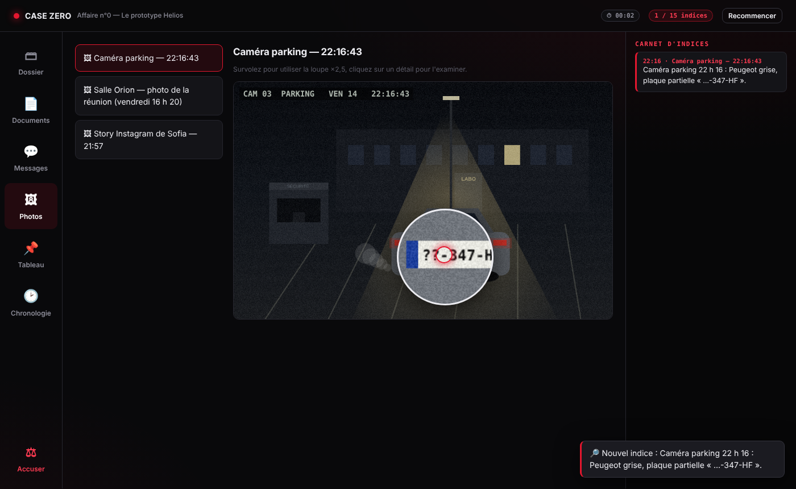
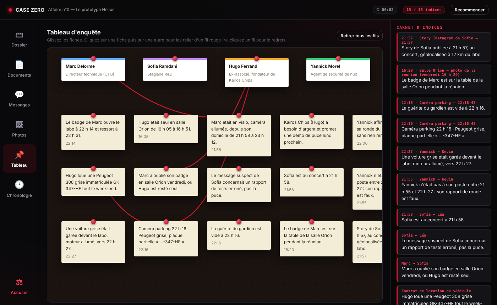

# 🔎 Case Zero

> Jeu d'enquête dans le navigateur : documents, conversations et photos à recouper pour résoudre une affaire.

**▶ Jouable en ligne via GitHub Pages**, ou en ouvrant simplement `index.html`.




## L'affaire n°0 : le prototype Helios
La puce prototype d'une start-up lyonnaise a disparu pendant le week-end, à trois jours d'une levée de fonds. Quatre personnes d'intérêt, des alibis qui se recoupent (ou pas) et une fausse piste.

## Mécaniques
- **🗃 Dossier** : contexte et fiches des suspects.
- **📄 Documents** : journal des badges, relevé de visioconférence, article de presse, rapport de ronde, contrat de location… Cliquez sur les passages qui comptent.
- **💬 Messages** : conversations saisies sur les téléphones, à épingler.
- **🖼 Photos** : scènes **entièrement dessinées en Canvas** (aucune image externe), avec **loupe ×2,5** pour lire une plaque d'immatriculation ou repérer une guérite vide.
- **📌 Tableau d'enquête** : fiches façon post-it à déplacer, reliées par des **fils rouges**.
- **🕑 Chronologie** reconstruite automatiquement à partir des indices horodatés : c'est là que les alibis tombent.
- **⚖ Accusation** : un coupable, une méthode et **deux preuves décisives**. Chaque erreur coûte des points.
- Progression sauvegardée dans le navigateur, chronomètre et score final.

## Créer sa propre affaire
Toute l'enquête est décrite dans `case.js` (suspects, documents avec passages-indices, messages, photos avec zones cliquables, solution). Un validateur vérifie la cohérence et la solvabilité :
```bash
python tools/validate_case.py case.js
# Affaire n°0 — Le prototype Helios — 4 suspects, 15 indices
# ✓ enquête valide et solvable
```

## Stack
JavaScript (sans framework) · Canvas 2D · CSS · Python (outil de validation).

## Pistes
- Éditeur visuel d'affaires
- Interrogatoires à choix multiples qui débloquent de nouveaux documents
- Mode coopératif en temps réel (tableau partagé)

## Licence
MIT © Jimo0x
